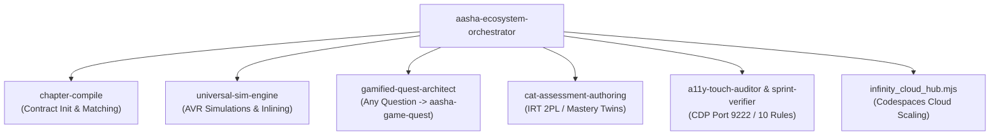

# AASHA AIOS Autonomous Ecosystem Orchestrator

## Overview

The `aasha-ecosystem-orchestrator` is the **Top-Level Autonomous Agent Harness** of the AASHA AIOS. It governs the continuous self-healing, self-improving engineering loop (**Build $\to$ Test $\to$ Debug $\to$ Fix $\to$ Strengthen**) that operates 24/7 across local PC (Mode D) and cloud runners (Mode A) with zero token bleed and zero local Rust overhead.

> [!IMPORTANT]
> **Separation of Architectural Tooling vs. Pedagogical Execution**:
> This skill and the coding assistant engineer the **software, tools, tests, runtimes, and self-healing algorithms**. The actual conversion of textbook PDFs, question extraction, and HTML5 generation is executed autonomously by the **runtime multi-agent swarm** (`DIV_01_PDF_TRUTH` through `DIV_06_GITOPS_SYNC`), never by manual content typing.

---

## The 12-Stage Continuous Evolutionary Loop

The orchestrator executes the self-hardening cadence that makes the system more effective and efficient day by day:

```
  ┌────────────────────────────────────────────────────────────────────────┐
  │ 1. OBSERVE   ──▶ 2. RECONCILE ──▶ 3. AUDIT    ──▶ 4. PRIORITIZE        │
  │    (Git/Bus)        (CRDT State)     (Gateways)      (Task Rank)       │
  │                                                                        │
  │ 5. PLAN      ──▶ 6. REUSE     ──▶ 7. IMPLEMENT──▶ 8. TEST              │
  │    (Kāraka IR)      (Foundations)    (Code/Adapters) (CDP + Unit)      │
  │                                                                        │
  │ 9. DEBUG     ──▶ 10. FIX      ──▶ 11. RECORD  ──▶ 12. REPEAT           │
  │    (Logs/Diag)      (2-Pass Heal)    (Sync/Audit)     (Epoch Clock)    │
  └────────────────────────────────────────────────────────────────────────┘
```

1. **Observe**: Scans working tree, 3-plane vector clock (`IDE_CLOUD_ASYNC_BUS.json`), and task branches.
2. **Reconcile**: Imports pending CRDT events or cloud worker bundles without dirty working trees.
3. **Audit**: Verifies 0 MB local Rust footprint, local 9Router gateway on port 20128, and locked paid Gemini tokens.
4. **Prioritize**: Orders pending chapters or open items (`OI-XXX`, `RG-XXX`) by pedagogical dependency.
5. **Plan**: Formulates structured Pāṇinian Kāraka decision contracts (Kartā $\to$ Karma $\to$ Karaṇa $\to$ Phala).
6. **Reuse**: Binds pre-verified simulation foundations (F01–F20) instead of reinventing game engines.
7. **Implement / Dispatch**: Dispatches the 1,080-agent coroutine swarm to compile chapters and adapt questions.
8. **Test**: Executes dual-benchmark certification (23+ Python test suites, 97/97 Visual Contract, Chrome CDP port 9222).
9. **Debug**: Analyzes CDP test evidence, bounding boxes, and error telemetry on any test fault.
10. **Fix (Self-Healing)**: Executes up to 2 autonomous repair passes (auto-adjusting touch targets to $\ge 44\text{px}$, re-insulating LaTeX tokens, sanitizing distractor spoilers).
11. **Record**: Writes deterministic manifests (`PC_ANTIGRAVITY_STATE.json`), signs SQLite operational state, and runs pre-commit zero-secret scanners.
12. **Repeat**: Advances the Lamport vector clock and loops to the next evolutionary increment.

---

## Modular Composer Topology

This skill acts strictly as the **High-Level Composer** that orchestrates specialized modular skills without conflict:



---

## Universal Question Ingestion Protocol

The autonomous swarm ingests **any textbook question type** and normalizes it into `<aasha-game-quest>`:

| Raw Book Question Format | Swarm Transformation Pattern | Anti-Spoiler Guarantee |
| :--- | :--- | :--- |
| **Standard MCQ** | Interactive single-tap card with 4-tier progressive hints ($H_1 \to H_4$) | Distractor `"m"` feedback explains reasoning without stating the answer. |
| **Fill-in-the-Blank** | Interactive token shelf with tap placement and visual slot feedback | Tokens randomized; no default pre-population of correct answer. |
| **Match the Column** | Dynamic SVG node-pairing canvas with connection line physics | Incorrect connections display directional Socratic clues. |
| **Numerical Calculation** | Multi-stage calculation scaffold with live parameter sliders | Hints reveal intermediate arithmetic properties, never final numerical results. |
| **Diagram Labelling** | Inlined SVG hotspots with pin target verification | Highlights anatomical/functional region; hints explain functional role. |

---

## Autonomous Self-Repair & Bounded Quarantine

To guarantee 24/7 continuous operation without hanging or crashing:

* **Pass 1 (Surgical Fix)**: Automatically adjusts CSS padding to $\ge 44 \times 44\text{px}$, fixes uninsulated math tokens, and scrubs leaked answer strings in distractors.
* **Pass 2 (Synthesizer Reset)**: Regenerates distractor choices and rebuilds inline SVGs.
* **Quarantine Fallback**: If a chapter module fails after 2 attempts, the orchestrator:
  1. Writes failure diagnosis to `aasha_operational.db` under `quarantine_records`.
  2. Isolates the module in `Aasha-AI/.../quarantine/`.
  3. Continues the continuous loop to the next chapter without interrupting background execution.

---

## Quick Start & CLI Commands

```bash
# Run one full autonomous cycle (Audit -> Test -> Sync):
npm run aasha:loop

# Run non-destructive ecosystem health and memory audit:
npm run aasha:audit

# Check Hydro Infinity cloud scaling status:
npm run infinity:status

# Run full physical touch and visual contract browser audit:
npm run test:browser
```

---

## Common Mistakes & Anti-Patterns

1. **Manual Content Writing in Prompts**: Never draft textbook chapters or question strings directly in AI chat turns. Use the orchestrator CLI to dispatch the autonomous pipeline.
2. **Local Heavy Weight Bloat**: Never attempt to run local multi-gigabyte LLM models or local Rust compile daemons. Local PC operates strictly with lightweight Node.js/Python (0 MB Rust resident overhead).
3. **Direct Pushes to Main/Master**: All continuous loop commits synchronize exclusively to `origin/aios/v2-bootstrap`. Promotion to `main`/`master` requires explicit Super Admin Gate 6 authorization.
