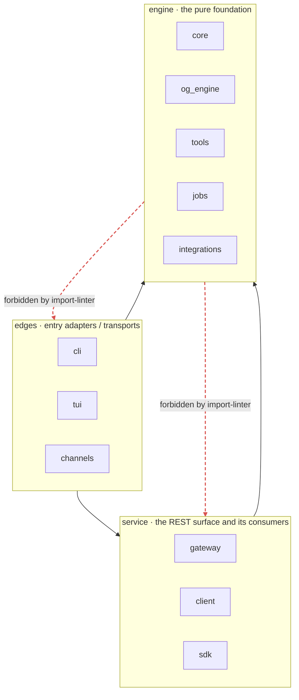

# Architecture

Hachi is a local-first autonomous agent engine. This document describes the
major components and how they interact. For deep analysis and design rationale see
`docs/strategy/00-recon.md` through `docs/strategy/09-execution-plan.md`.

---

## Overview

```
User input
    │
    ▼
┌─────────────────────────────────────────────────┐
│  Entry points (CLI / TUI / Gateway / Channels)  │
│  src/hachi/cli/main.py                          │
│  src/hachi/tui/cockpit/app.py                   │
│  src/hachi/gateway/fastapi_app.py               │
└──────────────────────┬──────────────────────────┘
                       │ session.chat()
                       ▼
          ┌────────────────────────┐
          │  Orchestrator          │  src/hachi/gateway/orchestrator.py
          │  (session boot, wiring)│
          └────────────┬───────────┘
                       │ run()
                       ▼
          ┌────────────────────────┐
          │  ExecutionLoop (ReAct) │  src/hachi/core/loop.py
          │  tool calls ↔ LLM     │
          └────────────┬───────────┘
              ┌────────┴────────┐
              ▼                 ▼
    ┌──────────────┐   ┌─────────────────┐
    │ ToolRegistry │   │ BaseLLMClient   │  src/hachi/core/llm.py
    │ (tools./)    │   │ (Anthropic API) │
    └──────────────┘   └─────────────────┘
```

---

## Key entry points

| Path | Role |
|------|------|
| `src/hachi/cli/main.py` | Typer CLI + in-process gateway runtime |
| `src/hachi/gateway/orchestrator.py` | Session boot: wires workspace, tools, LLM, memory |
| `src/hachi/core/loop.py` | ReAct execution loop — drives tool calling |
| `src/hachi/core/turn_context.py` | Frozen per-turn snapshot (no shared mutable state) |
| `src/hachi/og_engine/` | ObjectGraph (`.og`) parser and skill indexer |
| `src/hachi/tools/` | All LLM-callable tool implementations |
| `src/hachi/tui/cockpit/app.py` | Textual UI ("Hachi Cockpit") |
| `src/hachi/gateway/fastapi_app.py` | FastAPI control plane (REST + SSE) |
| `src/hachi/core/runtime_events.py` | Typed event contract consumed by TUI and gateway |

---

## Core loop (`src/hachi/core/loop.py`)

The loop implements the **ReAct** (reason + act) pattern:

1. Build a `TurnContext` — a frozen snapshot of the current turn state.
2. Call the LLM with the full message history + tool specs.
3. For each tool call in the response: validate via `PermissionGate`, dispatch to the
   matching `ToolSpec`, append the result.
4. If the response is a final text message, emit `session.chat.completed` and return.
5. If the iteration limit is reached, return a partial summary with `status=incomplete`.

**No shared mutable state per turn.** `TurnContext` is a frozen dataclass; all
accumulation happens in local lists that are flushed to the shared history only on
a clean turn exit.

---

## ObjectGraph (.og) skill system (`src/hachi/og_engine/`)

Skills are `.og` files, not markdown. Each file is a graph of typed nodes. The agent
reads skills in three ranked passes, stopping as soon as it has what it needs:

| Pass | Content | Cost |
|------|---------|------|
| **Pass 1 — index** | `::index` routing table (~30 tok / file) | Very cheap |
| **Pass 2 — dense** | `::dense` summaries for matching candidates | Cheap |
| **Pass 3 — full** | `::full` content for the single best node | Exact skill size |

Key components:

- **`SkillEngine`** (`engine.py`) — indexes `.og` files; provides `search()` (BM25),
  `peek()` (Pass 2), `resolve_node()` (Pass 3), and persistent usage tracking
  (`state_dir/skill_usage.json` via `get_hachi_paths()`).
- **`parse_og_file()`** (`parser.py`) — pure-Python parser; `.og` is data, never code.
- **`lint_og_file()`** (`engine.py`) — structural linter; `missing-index` and
  `dense-over-budget` are errors for skill-role nodes, blocking in CI.
- **Qualified node IDs** — nodes are indexed as `<file-stem>:<node>` to prevent
  silent shadowing between user, community, and built-in skill files.

Default skill library: `src/hachi/default_skills/**/*.og`

---

## Memory (`src/hachi/core/`)

Three-layer split:

| Layer | Location | Purpose |
|-------|----------|---------|
| **Active context** | In-memory message history | Managed per-turn by `MemoryManager`; compacted asynchronously via the jobs queue |
| **SessionStore** | `state_dir/sessions.db` (SQLite) | Per-session transcript; every turn appended |
| **MemoryVault** | `state_dir/chroma_vault/` (ChromaDB) | Long-lived semantic facts, split into `core_memory`, `user_profile`, `agent_profile`, `delegation_log` |

Memory writes go through the jobs queue (`src/hachi/jobs/queue.py`) — never
inline during the turn. `MemoryGuard` quarantines writes from untrusted content.
Failed writes surface in the `jobs/failed` read-model (visible in the TUI badge).

---

## Permission gating (`src/hachi/core/permissions.py`)

`device-permissions.og` (in the platformdirs config dir) declares:
- Allowed filesystem roots (reads and writes)
- Allowed / blocked shell commands
- MCP server toggles
- Integration scopes

`PermissionGate` wraps every OS-touching tool call and checks the gate **at call
time**, not as a prompt. Denials emit `tool.call.denied` runtime events.

---

## Sub-agent delegation (`src/hachi/core/sub_agent.py`)

`delegate_task(role="...", task="...")` creates a scoped `ToolRegistry`, loads the
matching `brain-<role>.og` via `RoleResolver`, and runs a child `ExecutionLoop` in
isolation. Results return via `delegation_log` in `MemoryVault`.

`RoleResolver` looks up role files in order:
1. `<platformdirs data_dir>/skills/roles/<role>.og` (user-defined overrides)
2. Legacy `~/.hachi/skills/roles/<role>.og` (read shim, for migration)
3. `src/hachi/default_skills/roles/<role>.og` (built-in)

---

## Runtime events (`src/hachi/core/runtime_events.py`)

All significant lifecycle moments emit typed events following `<domain>.<noun>.<verb>`
(e.g. `tool.call.started`, `session.chat.completed`, `jobs.write.failed`).
The TUI and gateway consume these via `RuntimeReadModels` — no direct coupling
between the loop and the display layer.

---

## Gateway / REST API (`src/hachi/gateway/fastapi_app.py`)

FastAPI control plane exposing:
- `POST /sessions` — create a session (lazy-boots the agent)
- `POST /sessions/{id}/messages` — send a message; returns JSON
- `GET  /sessions/{id}/events` — JSON snapshot of past events (paginated via `after`/`limit`)
- `GET  /sessions/{id}/stream` — SSE event stream (the real live-update channel; auto-reconnects)
- `GET  /health` — liveness probe
- `POST /v1/chat/completions` — OpenAI-compat facade

Start standalone: `uv run hachi gateway --host 127.0.0.1 --port 8787 --runtime`

---

## Frontend contract

The `frontend/` app generates TypeScript API types into
`frontend/src/lib/data/schema.d.ts` from `openapi/hachi-openapi.json` via
`openapi-typescript`. After **any** gateway route change, regenerate both:

```bash
uv run hachi gateway-openapi --output openapi/hachi-openapi.json
npm run --prefix frontend generate:api
```

CI enforces this via the `frontend-contract` job: `check:api` re-exports the schema and
`git diff --exit-code`s `schema.d.ts`, then `typecheck`. The hand-authored UI types live
in `src/lib/data/types.ts`; `schema.d.ts` is the generated transport contract
(`paths` / `components["schemas"]`). See **BB-4** in `docs/bug-bank.md`.

---

## Platform paths

All user data goes through `get_hachi_paths()` (`src/hachi/core/paths.py`),
which returns platformdirs-based paths:

| Directory | Contents |
|-----------|---------|
| `config_dir` | `settings.toml`, `device-permissions.og`, `brain.og` |
| `data_dir`   | `skills/` (user skill library) |
| `state_dir`  | `sessions.db`, `skill_usage.json`, `schedules.json`, `checkpoints/` |
| `cache_dir`  | Transient caches |

---

## Architecture decisions (ADRs)

Settled decisions live in [`DECISIONS.md`](docs/DECISIONS.md) — the running log, newest at the
bottom. A *major* architectural choice that needs alternatives analysis and a long-lived
reference is promoted to a numbered ADR under [`docs/architecture/adr/`](docs/architecture/adr/)
(`0001…`) and linked from its `DECISIONS.md` entry. The two-tier convention, the copy-me
template, and the index are in the [ADR README](docs/architecture/adr/README.md);
`scripts/check_adrs.py` (advisory in the gate) keeps every ADR well-formed and indexed.

---

## CI pipeline (`.github/workflows/ci.yml`)

| Job | What it checks |
|-----|---------------|
| `test` | `pytest -q` — full suite, on Linux + macOS + Windows |
| `security` | `hachi security-audit --fail-on-high` (PRs add `--fail-on-medium`); pip-audit; bandit |
| `lint` | `ruff check src tests` (blocking); full-tree `mypy` (advisory); `mypy-strict-gate.ini` (blocking on PRs); **the Rails** — `import-linter` layering (blocking) + `deptry`/`vulture`/complexity (advisory) |
| `skill-lint` | `python scripts/lint_skills.py` — 0 errors across shipped `.og` files |
| `benchmark` | `hachi skill benchmark --json --threshold 0.80` — token savings ≥ 80% |
| `eval` | `hachi eval run` — replays the eval corpus through the real loop; blocks loop regressions |
| `frontend-contract` | re-export OpenAPI, `check:api` diff on `schema.d.ts`, frontend `typecheck` |
| `docker-smoke` | `docker compose config` + build the backend & frontend images |

`scripts/preflight.py` runs these same checks locally in one command — get it green
before proposing a push.

### Enforced layering (the architectural rail)

`import-linter` (config in `pyproject.toml` `[tool.importlinter]`) makes the layering
below a **mechanical contract**, not a convention — a new import that crosses a forbidden
boundary fails the gate:



Solid arrows are the **allowed** direction of dependency; the red dashed arrows are what
`import-linter` **blocks** — the engine reaching back up into the service or the edges.

- `og_engine` is **pure** — it may depend on `core` and nothing else in the tree.
- The engine must not import the UI edges (`cli`, `tui`) or the `gateway` service.

A handful of pre-existing inversion **seams** (e.g. `core.runtime.resume → cli.main`,
`core.onboarding → gateway.workspace`) are frozen as commented `ignore_imports` entries —
visible debt to retire behind a `core`-owned control-plane protocol, not new couplings to
copy. Removing a seam makes its frozen entry error (so the allowlist self-cleans).
