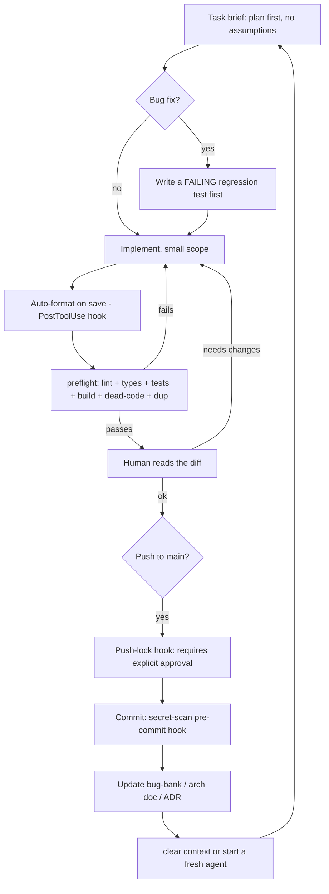

# Project Hachi — Guardrails Plan for Claude Code

_A system to stop regressions, architectural drift, and "fixed-bug-comes-back" whack-a-mole on a large, long-lived codebase._

---

## 0. Diagnosis: why Hachi is drifting

Your four symptoms are not four problems. They are one problem wearing four faces.

| Symptom                                | Real cause                                                                                        |
| -------------------------------------- | ------------------------------------------------------------------------------------------------- |
| Regressions after audit/refactor loops | Nothing **mechanically verifies** that old behaviour still works before changes land              |
| Architectural drift                    | Boundaries and conventions live in prose (CLAUDE.md / your head), not in **enforced rules**       |
| Bugs you already fixed come back       | The fix was never **locked with a regression test**                                               |
| Fixing the same bug 2–3 times          | Long, polluted sessions + no **memory** of the autopsy → the agent re-derives the broken solution |

The single realisation that fixes most of this: **a coding agent treats "task looks finished" as success, and will quietly override any rule written in prose to get there.** CLAUDE.md is advisory. The agent can talk itself out of advice. It cannot talk itself out of a failing exit code.

So the governing principle of this whole plan is:

> **Stop writing rules. Start enforcing them with the computer.** Anything you actually care about must be a gate, a hook, or a test — not a sentence in a markdown file. Treat every diff the agent produces as untrusted third-party code that has to _earn_ its way in.

Everything below is an application of that one idea.

---

## 1. The system at a glance

Eight layers. The bottom four are **mechanical** — they run whether the agent "wants" to or not. The top four are **process** — discipline that produces good input and catches what machines can't.

```
                 ┌─────────────────────────────────────────────┐
   PROCESS       │ 8. Memory      never bitten by a bug twice   │
   (discipline)  │ 7. The Map     architecture = living truth   │
                 │ 6. Hygiene     lean context, fresh agents    │
                 │ 5. The Plan    plan-before-code, no guessing │
                 ├─────────────────────────────────────────────┤
   MECHANICAL    │ 4. The Net     tests, esp. regression law    │
   (can't be     │ 3. The Rails   lint, boundaries, signatures  │
    argued       │ 2. The Locks   hooks block dangerous moves   │
    away)        │ 1. The Gate    one command must pass clean   │
                 └─────────────────────────────────────────────┘
```

What each layer kills:

- **Regressions** → Net (regression tests) + Gate (catches them before they ship) + Rails (boundaries hold)
- **Drift** → Rails (boundaries/signatures as build errors) + Map (arch doc) + anti-bloat
- **Bugs coming back** → Net (regression law) + Memory (bug-bank)
- **Same bug 2–3×** → Memory + Hygiene (clear context after the 2nd correction)

The development loop the whole system produces:



---

# PART A — The mechanical floor

These four layers are the highest-leverage work. If you only do Part A, you will already fix most of your pain.

## Layer 1 — The Gate

**One command that gates everything.** Define a single entry point — call it `preflight` — that runs, in one shot, and fails on _any_ of:

1. format check
2. lint (incl. your custom rules from Layer 3)
3. type check
4. the fast test suite
5. production build
6. dead-code / unused-dependency check
7. duplication check over a threshold

```jsonc
// package.json (Node example — translate to your stack, see the table at the end)
{
  "scripts": {
    "preflight": "npm run format:check && npm run lint && npm run typecheck && npm run test:fast && npm run build && npm run knip && npm run jscpd",
  },
}
```

Rules:

- **Nothing ships unless `preflight` passes clean.** This is the single highest-leverage practice in the entire plan. A change the agent can't verify is a change that doesn't land.
- **Make it deterministic before you make it comprehensive.** Run tests sequentially / pin seeds / kill time-based flakiness. _A flaky gate is worse than no gate_ — the moment a green run can fail, you start ignoring failures, and the gate is dead. Prove the suite passes several times in a row before trusting it.
- One command, not seven things to remember. The agent (and you) runs `preflight` and reads one verdict.

## Layer 2 — The Locks (Claude Code hooks)

Hooks are the deterministic layer of Claude Code. Configure them in `.claude/settings.json` (commit this — it ships the gates to every session and every subagent automatically). A `PreToolUse` hook that exits non-zero **blocks** the action; a `Stop` hook that exits non-zero **forces the agent to keep working**. These fire regardless of what the model "decides," which is exactly why they beat prose rules.

Wire these four:

**a) Red tests block "done."** A `Stop` hook runs the fast suite and refuses to let the agent declare completion while tests are red. (Guard against infinite loops with the `stop_hook_active` flag.)

```jsonc
{
  "hooks": {
    "Stop": [
      {
        "hooks": [
          {
            "type": "command",
            "command": "INPUT=$(cat); [ \"$(echo \"$INPUT\" | jq -r '.stop_hook_active')\" = 'true' ] && exit 0; cd \"$CLAUDE_PROJECT_DIR\" && npm run test:fast >/dev/null 2>&1 || { echo 'Fast tests are red. Fix them before finishing.' >&2; exit 2; }",
          },
        ],
      },
    ],
  },
}
```

**b) Push-lock on main.** A `PreToolUse` hook on `Bash` blocks `git push` to your protected branch unless you've explicitly approved it. This converts "ask before pushing" from a promise the agent can break into a wall it can't. (Implement approval as a sentinel file you create when you say yes, e.g. `touch .claude/.push-approved`; the hook checks for it and deletes it after. Simple and robust beats clever.)

```jsonc
{
  "hooks": {
    "PreToolUse": [
      {
        "matcher": "Bash",
        "hooks": [
          {
            "type": "command",
            "command": "CMD=$(jq -r '.tool_input.command // empty'); echo \"$CMD\" | grep -qE 'git +push.*(origin +)?(main|master)' && [ ! -f \"$CLAUDE_PROJECT_DIR/.claude/.push-approved\" ] && { echo 'Push to main requires explicit approval. Ask me first.' >&2; exit 2; }; rm -f \"$CLAUDE_PROJECT_DIR/.claude/.push-approved\"; exit 0",
          },
        ],
      },
    ],
  },
}
```

**c) Secret-scan at commit.** Best implemented as a **git `pre-commit` hook** (runs no matter who commits, agent or you), with a Claude Code `PreToolUse` hook as defense-in-depth. Block anything matching `API_KEY` / `SECRET` / `TOKEN` / private-key patterns and refuse to commit a `.env`. Use `gitleaks` if you want it serious; a regex is cheap insurance.

**d) Auto-format on write.** A `PostToolUse` hook on `Write|Edit|MultiEdit` runs the formatter so the agent never burns turns on whitespace and your diffs stay clean.

```jsonc
{
  "hooks": {
    "PostToolUse": [
      {
        "matcher": "Write|Edit|MultiEdit",
        "hooks": [
          {
            "type": "command",
            "command": "cd \"$CLAUDE_PROJECT_DIR\" && npx prettier --write \"$(jq -r '.tool_input.file_path')\" 2>/dev/null; exit 0",
          },
        ],
      },
    ],
  },
}
```

> Caution: hooks run with your full shell permissions and **no sandbox**. Keep them short, audited, and version-controlled. A misconfigured hook can do real damage.

## Layer 3 — The Rails (static enforcement of structure)

This is the layer most people skip, and it's the one that mechanically prevents _drift_. When the codebase has machine-enforced patterns, the agent conforms to them tightly. Add, and fold into `preflight`:

- **Lint + format config** — style and obvious smells become errors, not opinions.
- **Import-boundary rules** — declare which modules may import which (e.g. `dependency-cruiser` or `eslint-plugin-boundaries` in JS; `import-linter` in Python). This is how "keep the architecture clean" becomes a _build failure_ instead of a hope. This single tool does more against drift than any document.
- **Function-signature limits** — cap positional parameters (e.g. ESLint `max-params`). Left alone, the agent will slop 20–30 positional args into a function because "it can understand it." Force options-objects and small signatures; sprawling signatures are where silent regressions hide.
- **Dead-code / unused-deps detector** (`knip` in JS; `vulture` + `deptry` in Python). AI assistants are documented to regenerate logic instead of reusing it — this catches the orphans mechanically.
- **Duplication detector** (`jscpd`, multi-language) failing over a threshold (~5%). Same reason: agents copy-paste logic; this makes it a hard stop.

Plus one hard rule (enforced socially + by the dead-code/dup tools): **no new dependency without asking, and search for existing logic before writing new.**

## Layer 4 — The Net (tests — and the law that kills whack-a-mole)

**The regression law (this is the direct cure for "bugs I already fixed coming back"):**

1. When you hit a bug, **first write a test that fails** because of it.
2. _Then_ fix the bug.
3. Confirm the test goes green.
4. That test is now a **permanent** part of the suite.

Now the bug is physically locked: the moment the agent reintroduces it, `preflight` goes red and the Stop hook refuses to finish. Bugs stop coming back because the suite remembers them even when the agent doesn't.

**Test layers — and a warning.** Unit tests that just call the function prove almost nothing. You need a pyramid:

- **Unit / regression** — fast, deterministic, thousands run in seconds; these run on every `Stop`.
- **Integration / contract** — each service or module has a published API contract that is tested at check-in. (Pairs with Layer 7's boundaries.)
- **E2E / journey** — exercise the _real entry point_ (the frontend, the real endpoint) the way a user does. Define what must happen and what must **not** happen. If a journey test can't be written at this stage, record that as a TODO somewhere durable so a future session finishes it — don't let it silently vanish.

On coverage: aim high (many people target ~100%), but **value meaningful tests over the coverage number**, and review tests for _spec-vs-implementation_ — a test that just mirrors the buggy code locks the bug in. Be honest with yourself: at scale you cannot review every line of every test; that's exactly why the gate, not your eyeballs, is the thing that has to scale.

---

# PART B — The process layer

Mechanical floor stops bad code from landing. This layer stops bad code from being _written_ and stops the agent from forgetting.

## Layer 5 — The Plan (plan before any code)

Long tasks succeed or fail at the planning stage. A vague "go implement X" produces sloppy, drift-prone output. The protocol:

1. **Use Claude Code's plan mode** for anything non-trivial. Get a plan before a single edit.
2. **Have the agent critique its own plan** — ask it to find blockers, missing steps, sloppy instructions, and unstated assumptions. Refine until you hit diminishing returns.
3. **Surface the decisions that are yours to make** before execution starts. ("Are there choices you need from me before running?")
4. **Demand 100% alignment, zero assumptions.** You and the model must agree on the plan before it runs.
5. **Break big work into milestones** (a PRD with M1…Mn). Implement one milestone at a time; review and refactor between stages. Smallest features might be M1–M5; large ones M1–M40+.
6. **Scope each task small.** A tight brief + just-enough surrounding context beats a sprawling "do everything" prompt every time.

A simple, ownable two-tier version of the multi-agent setups people rave about: an **architect** session plans and maintains the architecture doc + writes a short task brief; a **worker** session executes only that brief and writes a one-paragraph completion report; you discard the worker. That's the whole loop — and you'll actually understand it, which matters more than copying someone's 4-agent cathedral you can't debug.

## Layer 6 — Context hygiene

Drift and reintroduced bugs are _born in long, polluted sessions._

- **Keep context lean.** Output quality drops noticeably past roughly half the window. Watch the meter; don't let one session sprawl.
- **`/clear` aggressively** — after finishing a task, and _especially_ after you've corrected the agent twice on the same thing. The third correction should be a fresh agent, not more shouting into a poisoned context.
- **Prefer fresh agents to resuming.** A good health check for your whole setup: _how well can a brand-new agent pick up the task vs. one already deep in session?_ If fresh agents struggle, your docs/briefs are too thin — fix that, don't lean on session memory.
- **Use a handoff note** when you must continue: have the ending session write down state, decisions made, and next steps so the next agent starts informed, not cold.
- **Read every diff.** Treat AI output as untrusted third-party code; that read-through _is_ your code review. This is the one piece of vigilance you cannot automate away — small drifts compound fast.

## Layer 7 — The Map (architecture as living truth)

- Keep **one light architecture document** that is the current truth of the repo — not exhaustive, just the shape.
- Use **Mermaid sequence diagrams** for important flows and **C4 diagrams** to draw module/service boundaries. Visual boundaries dramatically reduce architectural drift.
- Put **nuanced detail in code comments next to the code**, not buried in a docs folder. The agent gets far better attention on a comment beside the function than on a paragraph three directories away. Docs are for the overview; comments are for the nuance.
- Record decisions as **ADRs** (`docs/adr/`) so the agent doesn't relitigate settled choices and reintroduce rejected approaches.
- Give each business capability a **separate module/service with a published API contract**, and test that contract at check-in. Architectural simplicity + contracts is what makes the system legible to a fresh agent.

## Layer 8 — Memory (never bitten by the same bug twice)

This is what stops you fixing the same bug three times.

- Keep a **bug-bank**: every non-trivial bug gets a short autopsy — root cause, the fix, and a link to the regression test that locks it.
- **Keep CLAUDE.md lean.** Long rule files get ignored (and the agent overrides them anyway). The file should hold only the few inviolable rules + _pointers_ to the bug-bank and arch doc — not the knowledge itself.
- **Inject memory mechanically at session start.** A `SessionStart` hook can print the relevant bug-bank "gotchas," the current branch, and the arch-doc location into context, so the agent never starts cold and planning begins with the warnings already loaded.
- **Start simple and own it.** A structured `docs/bug-bank.md` (or a folder of short autopsies) beats a vector-DB/RAG/MCP memory server you don't understand. Graduate to an MCP-backed memory only once the simple version is clearly the bottleneck. The memory system you understand is the one that works.

_(Advanced, later: role-separated subagents via `.claude/agents/_.md` — e.g. Architect/Engineer/Security with Security as the merge gate — and adversarial verification by fresh-context subagents that check assumptions without polluting the main agent's context. Powerful, but earn it after the floor is solid.)\*

---

## The lean CLAUDE.md

Keep it short. Here's the whole thing — resist the urge to grow it; push knowledge into the bug-bank, rules into hooks, and patterns into linters.

```markdown
# Hachi — Agent Rules

## Non-negotiable

- Never push to main without my explicit OK in this conversation.
- Run `npm run preflight` and get it green before proposing a push.
- For EVERY bug fixed: write a failing test first, then fix, then confirm green.
- Reuse existing code. Do NOT add a dependency without asking. Search before writing new logic.
- Stay in the scope of the current task brief. If scope grows, stop and ask.

## Before knowledge / decisions

- Check `docs/bug-bank.md` for prior autopsies before debugging.
- Check `docs/architecture.md` and `docs/adr/` before changing structure.

## Workflow

- Plan first for non-trivial work; get the plan approved before editing.
- Update the bug-bank / arch doc / relevant ADR as part of the change.
```

---

## Phased rollout (do NOT build all of this at once)

The people who succeed start small and grow a system they own. Ship each phase and _live with it_ before adding the next.

**Phase 0 — today, ~1 hour (zero infra, huge return)**

- Drop in the lean CLAUDE.md above.
- Adopt the regression law by hand: every bug fix starts with a failing test.
- Adopt `/clear` discipline, especially after the 2nd repeated correction.

**Phase 1 — the Gate + the Locks (~half a day; the biggest single win)**

- Build `preflight`. Make the test suite deterministic and prove it passes repeatedly.
- Wire the four hooks: red-tests-block-Stop, push-lock, secret-scan (git pre-commit), auto-format.

**Phase 2 — the Rails (~half a day)**

- Add lint/format, import-boundary rules, `max-params`, dead-code, and duplication checks. Fold every one into `preflight`.

**Phase 3 — the Map + Memory**

- Write the light arch doc + a couple of Mermaid/C4 diagrams. Start `docs/bug-bank.md`. Add the `SessionStart` injection hook. Start logging ADRs.

**Phase 4 — advanced, optional**

- Role-separated subagents, adversarial verification, MCP-backed memory — only once Phases 0–3 are habitual.

---

## A bootstrap prompt (paste into Claude Code on Hachi)

> Help me harden this repo against AI-introduced regressions, drift, and bloat. Do these in order, and **show me each step before applying it**:
>
> 1. Make my test runner deterministic (no flaky parallel/time-based failures) and confirm the fast suite passes several times in a row.
> 2. Add a single `preflight` script that runs and fails on: format check, lint, type check, fast tests, production build, dead-code/unused-deps, and duplication (>~5%). Install the dead-code and duplication tools as dev dependencies.
> 3. Add a `Stop` hook that refuses to finish while the fast tests are red (guard against infinite loops).
> 4. Add a `PreToolUse` hook that blocks `git push` to main unless I've explicitly approved a push in this conversation.
> 5. Add a git pre-commit secret-scan hook that blocks API keys/tokens and any `.env`.
> 6. Add a `PostToolUse` auto-format hook on file writes.
> 7. Write a short CLAUDE.md: never push without my OK; run `preflight` before every push; reuse code and never add a dependency without asking; for every bug fixed, add a regression test first; check `docs/bug-bank.md` before debugging.
>
> Keep the rules file short — long rule files get ignored. As you go, explain the difference between hooks (enforced) and written rules (advisory).

---

## Honest tradeoffs

- **You still can't stop paying attention.** No setup removes the need to read diffs and stay vigilant; small drifts compound fast. The system _reduces_ drift-correction work per cycle — it doesn't eliminate it.
- **Reviewing everything doesn't scale.** That's the point of the mechanical floor: reserve scarce human review for high-risk diffs and let the gate carry the rest.
- **Determinism first.** Resist adding checks to a flaky gate — fix flakiness before you add power, or you'll train yourself to ignore red.
- **Don't over-engineer memory or multi-agent.** A markdown bug-bank you understand beats a RAG cathedral you don't. Complexity you can't debug is just a different flavour of drift.

## The payoff worth optimising for

After a few months of this, the real win is _banking_: each solved problem — a hook, a skill, a reusable module, a regression test — becomes infrastructure you carry into the next task and the next project. Your agents stop working from scratch and start working from a playbook they help extend. Solve the duplication problem, the push-safety problem, the regression problem **once** — for the next twenty things you build, not just for Hachi today.
