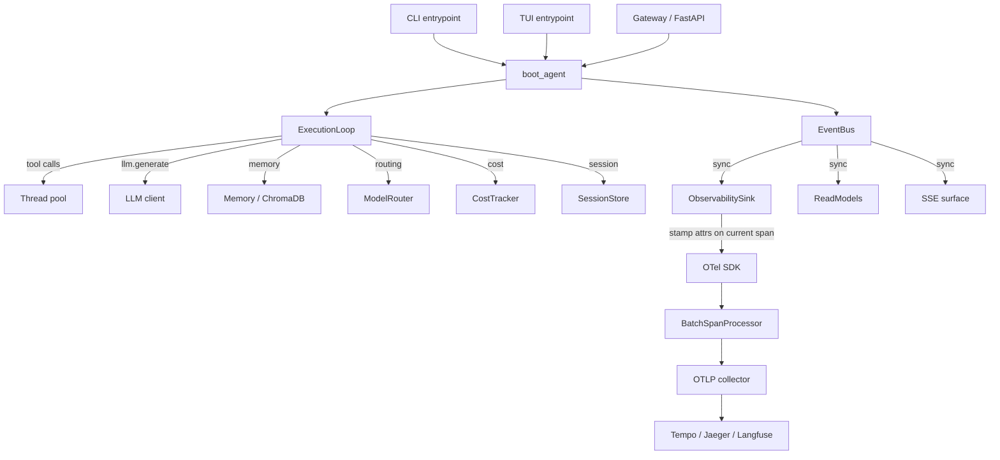
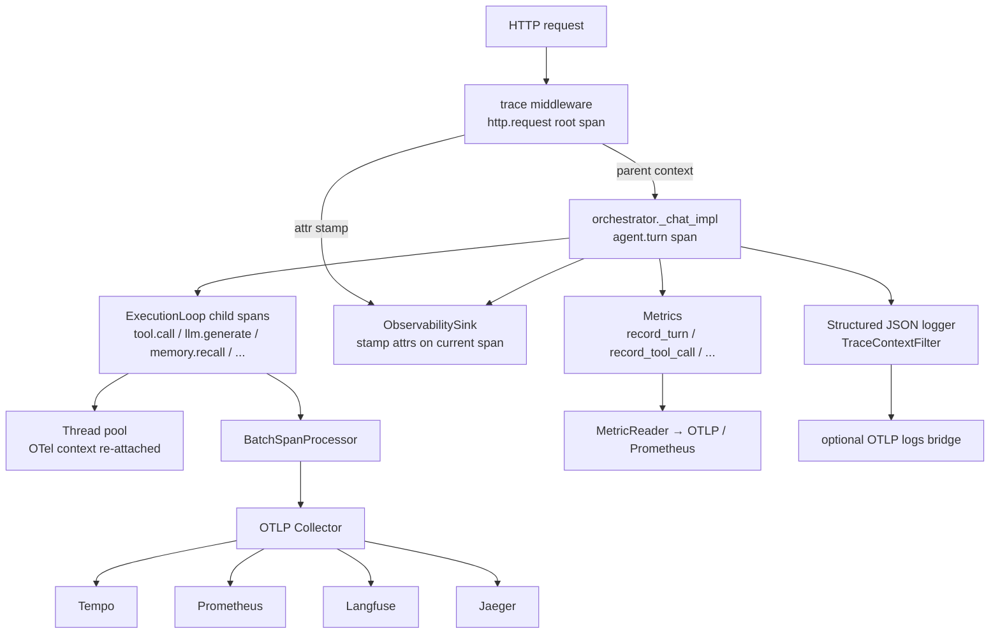

# 21 — Observability, Telemetry & Diagnostics

> Status: **Active** (Phases 0–5 implemented; Phases 6–8 / frontend next pass).
> Decision records: ADR-0005.  Configuration reference: `docs/guides/configuration.md`.

## 1. Overview & goals

Hachi's observability goal: answer *why did this request fail / why was it slow / which agent,
tool, or prompt caused it / who's affected / how do I reproduce it?* — and generate a bug report
automatically.

The platform is **OpenTelemetry-first, vendor-agnostic, event-driven**:

- **Backend spans / traces** flow through `core/tracing.py` → OTel `BatchSpanProcessor` →
  an OTLP collector (Tempo / Jaeger / Langfuse) or a console exporter.  The collector is
  configuration; the app never knows which backend is receiving.
- **Metrics** flow through `core/obs/metrics.py` → OTel `MeterProvider` → Prometheus / any OTLP
  metrics backend.
- **Structured logs** (JSON) flow from every entrypoint's root logger through a
  `TraceContextFilter` that injects `turn_id`, `session_id`, and `otel_trace_id`.
- **Events** are the bus wire format (`RuntimeEvent`); the `ObservabilitySink` stamps attributes
  and span-events onto the *currently active span* (attribute stamper, not span emitter).
- **Frontend** (Phase 6–8, next pass): OTel JS web SDK → W3C `traceparent` propagation →
  `POST /telemetry` ingest (Phase 7) → same collector path.

**Non-goals for v1:** rrweb full-DOM session replay; multi-user principal modeling beyond the
`principal` field; log aggregation shipping; trace sampling strategy.

## 2. Current architecture



### Principal boundary

The bearer token is hashed (`TraceContext.hash_principal`, SHA-256, first 16 hex chars) before
it ever reaches a span or log record.  No raw credential leaves the process.

### Existing turn root

`orchestrator.py::_chat_impl` (line ~1474) opens the `agent.turn` **root span** and binds the
per-turn `TraceContext`.  This is the sole owner of the turn root — `core/loop.py` adds *child*
spans under it.

## 3. Existing telemetry foundation (reuse — do not rebuild)

| Module | What it provides |
|--------|-----------------|
| `core/tracing.py` | Own `TracerProvider`, `setup_tracing`, `configure_from_env`, `setup_from_config(kind, endpoint)`, `span()` CM, `add_span_attributes()`, `add_span_event()`. BatchSpanProcessor (non-blocking). Graceful no-op when SDK absent. |
| `core/obs/trace.py` | `TraceContext(trace_id=turn_id, session_id, principal=sha256(token)[:16], surface)`; `bind()`; `copy_otel_context` / `attach_otel_context` for thread-pool span nesting. |
| `core/obs/metrics.py` | 10-instrument facade (`setup_metrics`, `setup_from_config`, `record_turn/tool_call/provider_error/route_selection`, `TurnTimer`, cache counters, queue-depth gauge). |
| `core/obs/sink.py` | `ObservabilitySink` subscribed to EventBus `"*"` — stamps attributes and span-events onto the *current* span (not a span emitter). |
| `core/obs/logging_setup.py` | `setup_logging` (JSON + text), `traced_logger`. Called by CLI/gateway/TUI entrypoints. |
| `core/obs/envelope.py` | `TelemetryEnvelope` — canonical schema unifying backend + frontend; `from_runtime_event(event, ctx, span=None)`. |
| `core/obs/spans.py` | Span-name constants, attribute-key constants, `ALLOWED_SPAN_ATTRS`, `DENY_METADATA_KEYS`. Single source of truth. |
| `core/event_bus.py` | Thread-safe pub/sub, sync + async(JobQueue), pattern matching. `RuntimeEvent(name, payload, timestamp)`. |
| `core/runtime_events.py` | 42-event taxonomy (verified count); payloads redacted upstream. |
| `core/cost.py` | `CostTracker.record`, `cache_metrics`, per-model/provider/feature snapshots; `daily_spend` ledger. Records cost/token metrics in `record()`. |
| `core/session_store.py` | `interaction_log` (per-turn audit: turn_id, tokens, cost, rating) + `daily_spend`. |
| `core/loop.py` | Real spans `span("tool.call")` (line 517) and `span("llm.generate")` (line 1027); thread-pool OTel handoff via `copy_otel_context` (line 1194) / `attach_otel_context` (line 510). |
| `gateway/orchestrator.py` | `_chat_impl` opens the `agent.turn` root span (line 1474) and binds `TraceContext`. `boot_agent` calls `setup_from_config` / `setup_metrics` when `[observability] enabled=true`. |
| `gateway/fastapi_app.py` | Request-tracing middleware (line ~TBD) injects W3C `traceparent`, records `http.request` root span. |
| `gateway/middleware/trace.py` | Pure ASGI request-tracing middleware (Phase 4). |

## 4. Gaps closed (Phases 0–5)

| # | Gap | Fix |
|---|-----|-----|
| G0 | Doc was a second observability source of truth | This doc refreshed; ADR-0005 amended |
| G1 | `[observability]` config dead — `setup_from_config`/`setup_metrics` never called at boot; `settings.py` docstring falsely claimed otherwise | Phase 0: inserted setup block in `boot_agent`; docstring fixed |
| G2 | ObservabilitySink emitted zero-duration marker spans → no real trace waterfall | Phase 2: sink demoted to attribute-stamper |
| G2b | Sink-based enrichment disappeared when `events.bus_funnel=false`; undocumented | Phase 0: degraded-mode warning; Phase 2: direct spans still work without the bus |
| G3 | Metrics fully dormant — no `record_*` call sites, no config-driven exporter | Phase 3: call sites + `setup_from_config` wired |
| G4 | No gateway request-tracing middleware, no W3C `traceparent`, no request metrics | Phase 4: pure ASGI middleware |
| G5 | Logging bootstrap dead code; no entrypoint called `setup_logging()` | Phase 5: entrypoints wired; JSON formatter + `TraceContextFilter` |
| G6 | No canonical event envelope; `trace_id`/`otel_trace_id` conflated | Phase 1: `envelope.py` + `spans.py` |

## 5. Proposed (implemented) architecture



**Key invariants:**
- Spans are created where work happens (`with span(...)` wrappers); events stamp attributes / span-events onto the *active* span.
- The waterfall is owned by `with span()` wrappers, not the sink.
- Logs are not modeled as an EventBus subscriber.
- `events.bus_funnel=false` → direct spans/metrics/logging still work; only sink-based enrichment is unavailable (boot logs a warning).

## 6. Design decisions

| DD | Decision |
|----|----------|
| DD0 | No second observability source of truth — update `21-observability.md` + ADR-0005, never fork |
| DD1 | Separate `turn_id` (Hachi correlation) from exported OTel `trace_id` (W3C distributed trace) |
| DD2 | Waterfall via `with span()` wrappers + sink demotion (sink becomes attribute stamper) |
| DD3 | Additive `TelemetryEnvelope` with exporter adapters outside the core dataclass |
| DD4 | OTLP-everywhere (vendor = collector config, not app code) — `[observability]` extra already declares the dep |
| DD5 | Frontend = OTel JS web SDK (next pass, pre-authorized) |
| DD6 | Backpressure/offline via `SQLiteJobQueue` (backend) + IndexedDB (frontend, next pass) |
| DD7 | Privacy via `ALLOWED_SPAN_ATTRS` / `DENY_METADATA_KEYS` in `spans.py`, enforced at the envelope boundary |
| DD8 | Lightweight replay keyed by `turn_id` (`otel_trace_id` as secondary pivot, next pass) |
| DD9 | Degraded mode: `enabled=true` + `bus_funnel=false` → warning at boot; direct spans/metrics/logging still work |

## 7. Trace model

```
[remote traceparent]
        │
 http.request          ← Phase 4 middleware; present for gateway path; absent for CLI/TUI
        │
 agent.turn            ← orchestrator.py:1474; always present when tracing is active
   ├── memory.recall   ← loop.py (child span added in Phase 2)
   ├── tool.call       ← loop.py:517; nested under turn via thread-pool context re-attachment (loop.py:1194/510)
   └── llm.generate    ← loop.py:1027
```

**Correlation identity:**
- `turn_id` — Hachi's durable join key for diagnostics, bug reports, read-model correlation. Stable across restarts.
- `otel_trace_id` — the W3C distributed-trace id; transport-driven once `traceparent` is supported. May differ from `turn_id`.
- Both are exposed in span attributes and the `TelemetryEnvelope`.

**Idempotency replay branch (Phase 4):** A replayed `POST /messages` (idempotency key hit at `fastapi_app.py:955`) produces an `http.request` span but **no `agent.turn`** (the turn never ran). This is correct and tested.

## 8. Span attribute conventions

All attribute keys defined in `core/obs/spans.py`. Safe fields enumerated in `ALLOWED_SPAN_ATTRS`.  Denied fields (`prompt_preview`, `user_input`, raw `authorization`, `*_body`, `*_content`, retrieved memory bodies) are enforced in `from_runtime_event` via `DENY_METADATA_KEYS` — they never reach a span, log record, or exported envelope.

Standard attributes:
| Attribute | Span | Description |
|-----------|------|-------------|
| `hachi.turn_id` | agent.turn | Hachi turn correlation id |
| `hachi.session_id` | agent.turn, http.request | Session id |
| `hachi.otel_trace_id` | agent.turn | Exported OTel trace id (when W3C parent present) |
| `hachi.surface` | agent.turn | `cli`\|`tui`\|`web`\|`webhook`\|`schedule` |
| `hachi.principal` | agent.turn | SHA-256 token hash (first 16 hex chars) |
| `tool` / `tool_name` | tool.call | Tool name |
| `model` | llm.generate | Model id |
| `http.method`, `http.route`, `http.status_code` | http.request | Standard HTTP attributes |

## 9. Metrics catalog

All instruments defined in `core/obs/metrics.py`. Activated when `[observability] metrics_enabled=true`.

| Instrument | Kind | Labels | Description |
|-----------|------|--------|-------------|
| `hachi.turns.total` | Counter | `surface` | Agent turns completed |
| `hachi.tool_calls.total` | Counter | `tool`, `error` | Tool calls executed |
| `hachi.provider_errors.total` | Counter | `model`, `kind` | Provider/LLM errors |
| `hachi.route_selections.total` | Counter | `capability`, `model` | Model route selections |
| `hachi.turn.latency_ms` | Histogram | `surface` | Turn wall-clock latency |
| `hachi.tool.latency_ms` | Histogram | `tool`, `error` | Tool call latency |
| `hachi.llm.latency_ms` | Histogram | `model` | LLM generation latency |
| `hachi.memory.latency_ms` | Histogram | — | Memory recall latency |
| `hachi.tokens.total` | Counter | `model`, `kind` | Tokens used (input/output/cache) |
| `hachi.cost.usd.total` | Counter | `model`, `provider`, `feature` | Cumulative cost |
| `hachi.cache.hits.total` | Counter | — | Cache hit count |
| `hachi.cache.calls.total` | Counter | — | Cache call count |
| `hachi.jobs.queue_depth` | Observable Gauge | — | Job queue depth (registered at boot) |

**Cardinality budget:** labels use only `surface/tool/model/provider/capability/kind/error` — never free-text or ids.

## 10. Logging strategy

- **Text mode** (default, `log_format="text"`): existing text format; `TraceContextFilter` injects `turn_id`/`session_id` as extra fields.
- **JSON mode** (`log_format="json"`): stdlib JSON formatter → `{ts, level, logger, message, turn_id, session_id, otel_trace_id, otel_span_id, exc_info}`.  All existing `getLogger(__name__)` calls emit correlated JSON with zero call-site churn.
- **OTel logs bridge** (optional follow-on in Phase 5 after JSON is stable): `LoggingHandler` → OTLP logs.
- Bootstrap: `setup_logging()` is called by CLI (`cli/main.py`), gateway (`fastapi_app.py`), and TUI entrypoints.  The `HACHI_LOG_LEVEL` env var sets the root level (default `WARNING`).

## 11. Privacy model

- **Emit-time redaction:** `runtime_events.py` scrubs secrets from event payloads before they reach the sink.
- **Span allowlist:** `spans.py::ALLOWED_SPAN_ATTRS` (correlation ids, `role/model/status/duration/tool_name`, metric label keys).
- **Deny list:** `spans.py::DENY_METADATA_KEYS` — `prompt_preview`, `user_input`, raw `authorization`/bearer, `*_body`/`*_content` patterns, retrieved memory bodies.  The envelope's `metadata` catch-all filters through this.
- **Principal hashing:** `TraceContext.hash_principal(raw)` → SHA-256[:16]; no bearer token leaves the process.
- **Self-hosted:** local-only by default; OTLP export is opt-in and targets an operator-controlled collector.

## 12. Configuration

See `docs/guides/configuration.md` § `[observability]` for the full reference.  Only add settings when the behavior is wired — no dead knobs.

```toml
[observability]
enabled = true            # master switch
exporter = "console"      # "console" | "otlp" | "langfuse"
endpoint = ""             # OTLP endpoint URL (optional; falls back to OTEL_EXPORTER_OTLP_ENDPOINT)
metrics_enabled = true    # also initialise the metrics facade
log_format = "json"       # "text" | "json"
```

**Degraded mode:** `enabled=true` + `[events] bus_funnel=false` → boot emits a `WARNING`; direct spans/metrics/logging still work; sink-based attribute enrichment is unavailable until the bus is re-enabled.

**Gate / OTLP extra:** the `[observability]` extra (`pyproject.toml`) declares `opentelemetry-exporter-otlp-proto-http>=1.27.0`.  OTLP tests require `uv sync --extra observability`; the console + in-memory paths run with `[tracing]` only.

## 13. Rollout plan

| Phase | Scope | Status |
|-------|-------|--------|
| 0 | Fix dead wiring + degraded-mode warning | Done |
| 1 | `envelope.py` + `spans.py` (schema foundation, PII allowlist) | Done |
| 2 | Real trace waterfall (sink demotion; child spans in loop) | Done |
| 3 | Metrics activation + full instrument catalog | Done |
| 4 | Gateway request-tracing middleware + W3C `traceparent` | Done |
| 5 | Structured logging (JSON formatter + `TraceContextFilter`) | Done |
| 6 | Frontend OTel JS web SDK (next pass, authorized) | Deferred |
| 7 | `POST /telemetry` ingest + `GET /diagnostics/*` API | Deferred |
| 8 | In-app DevTools `/diagnostics` route + one-click bug report | Deferred |

## 14. Folder structure

```
src/hachi/core/obs/
  trace.py          — TraceContext, bind, copy/attach/detach OTel context
  metrics.py        — 10-instrument facade, setup_from_config, register_gauge_source
  sink.py           — ObservabilitySink (attribute stamper, not span emitter)
  logging_setup.py  — setup_logging, traced_logger, JSON formatter, TraceContextFilter
  envelope.py       — TelemetryEnvelope, from_runtime_event, to_dict
  spans.py          — span-name constants, attr-key constants, ALLOWED_SPAN_ATTRS, DENY_METADATA_KEYS
src/hachi/gateway/
  middleware/trace.py  — pure ASGI request-tracing middleware (Phase 4)
docs/architecture/
  21-observability.md  — this document (refreshed 2026-07-06)
  adr/0005-observability-correlation-and-injected-exporter.md
docs/guides/
  configuration.md     — operator-facing config reference
```

## 15. Extensibility

- **Add a backend:** change collector config only (no app code).
- **Add a new event sink:** subscribe to the EventBus.
- **Add a new frontend exporter:** implement the interface in `frontend/src/lib/telemetry/`.
- **New span:** add a `with span(SPAN_NAME)` wrapper at the work seam; add the name to `spans.py`.
- **New metric:** add the instrument in `metrics.py`, add a `record_*` call at the work seam.

## 16. What could break

- **Context propagation into threads** is subtle.  *Guard:* `test_obs_waterfall.py` asserts `tool.call` spans nest under `agent.turn` (parent/child).
- **Overhead when enabled.** *Guard:* spans are no-ops when unconfigured (`tracing.py:170`); disabled-path timing assertion in `test_obs_tracing_gate.py` validates the promise.
- **Idempotency replay branch:** `http.request ⊃ agent.turn` is false for replays.  *Guard:* Phase 4 tests assert this branch explicitly.
- **Sink demotion breaks three old tests** (CX2 — see `docs/DECISIONS.md`): rewrites are intentional contract changes, not weakened tests.
